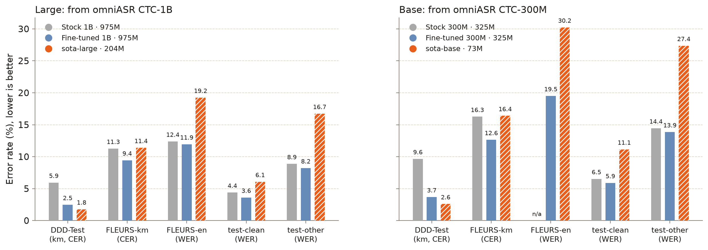
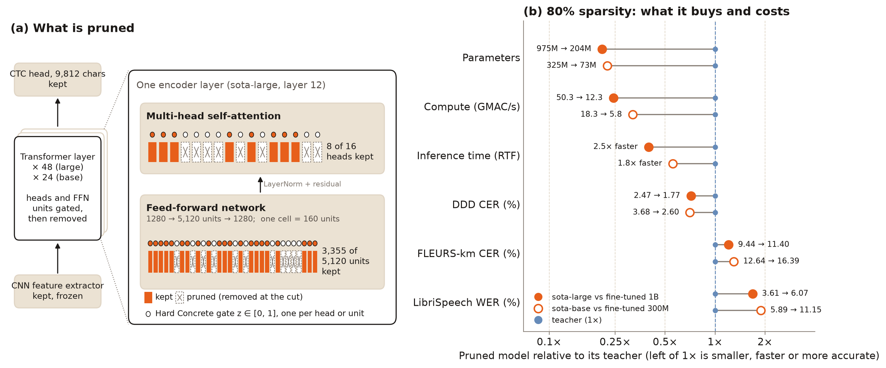
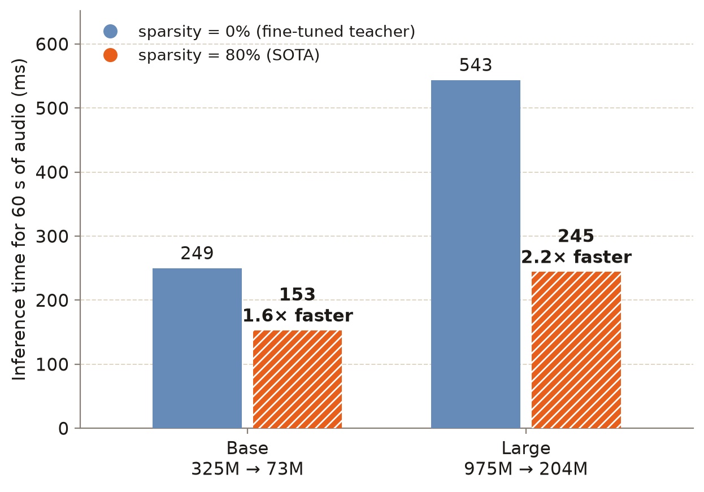

<div align="center">
  
  
</div>

<hr>

<p align="center">
  <a href="https://github.com/netra-ai-lab/SOTA"><b>GitHub</b></a> |
  <a href="https://huggingface.co/Darayut/sota-base"><b>Sota-base</b></a> |
  <a href="https://huggingface.co/Darayut/sota-large"><b>Sota-large</b></a> |
  <a href="https://huggingface.co/Darayut/omniASR-CTC-1B-km-en"><b>Fine-tuned 1B</b></a> |
  <a href="https://huggingface.co/Darayut/omniASR-CTC-300M-km-en"><b>Fine-tuned 300M</b></a> |
  <a href="https://huggingface.co/datasets/Digital-Divide-Data/khmer-speech-dataset"><b>Khmer Dataset</b></a>
</p>

<p align="center">
  
  
  <a href="https://huggingface.co/Darayut/sota-base"></a>
</p>

<h2>
<p align="center">
  SOTA: Structured Pruning of Omnilingual ASR for Khmer and English
</p>
</h2>

<p align="center">
  Khmer and English speech in, text out. Two compact models, 73M and 204M parameters, pruned from Meta's Omnilingual ASR.
</p>

<p align="center">
  
</p>

<p align="center">
  <em>Test error for each size: the stock Omnilingual model, our fine-tuned teacher and the pruned SOTA model. Lower is better. On DDD, the pruned models beat both larger models; on LibriSpeech they keep 1.7–1.9× the teacher's error.</em>
</p>

## 1. Abstract

This repository presents SOTA, a pair of **73M- and 204M-parameter** CTC speech recognisers for Khmer and English. They are built by structurally pruning Meta's Omnilingual ASR CTC models (`omniASR_CTC_300M` and `omniASR_CTC_1B`) to **80% encoder sparsity**. The recipe follows *Fine-tune Before Structured Pruning*:
1. The full model is fine-tuned on the target languages.
2. Hard Concrete L0 gates remove attention heads and FFN units while the model is distilled to that fine-tuned teacher.
3. The pruned model recovers with CTC plus distillation of the teacher's output distribution.

On the DDD test set, the 204M model reaches **1.77% CER**, against 2.47% for its 975M teacher, at a quarter of the compute (12.3 against 50.3 GMAC per second of audio). The 73M model reaches **2.60% CER**, below its 325M teacher's 3.68%, at 5.8 GMAC/s.

## 2. Dataset

SOTA was trained on about **1,537 hours** of speech, mixed 50/50 between Khmer and English by audio seconds. FLEURS is fixed at 20% of each language's audio and repeated as needed.

### Sources

| Dataset | Type | Size | Domains |
| :--- | :--- | ---: | :--- |
| [DDD Khmer Speech](https://huggingface.co/datasets/Digital-Divide-Data/khmer-speech-dataset) | Khmer speech | 1,058 h | Cambodian culture, 61 topics, native speakers |
| [FLEURS](https://huggingface.co/datasets/google/fleurs) km_kh train | Khmer read speech | 7.1 h | Wikipedia sentences |
| [LibriSpeech](https://www.openslr.org/12) train-clean-100 + 360 | English read speech | 464 h | Audiobooks |
| [FLEURS](https://huggingface.co/datasets/google/fleurs) en_us train | English read speech | 7.5 h | Wikipedia sentences |
| **Total** | | **1,537 h** | |

### Preprocessing

1. **Held-out sets.** The DDD test set, a DDD dev pool and an exclude list are removed from DDD training at the shard-row level.
2. **Duration filter.** Utterances shorter than 1 s or longer than 25 s are dropped.
3. **Resampling.** Audio is resampled to 16 kHz mono, which affects some 48 kHz DDD rows.
4. **Text normalisation.**
   - NFC, with zero-width characters removed and whitespace collapsed; English is lowercased.
   - Text is filtered to the Omnilingual character vocabulary, which has no Khmer punctuation such as `។`. This drops 1.2% of DDD characters.
5. **Loudness normalisation.** Each utterance is normalised to zero mean and unit variance, as in Omnilingual ASR.

## 3. Model Architecture

<p align="center">
  
</p>

<p><em>Figure 1: Structured pruning removes whole attention heads (MHA) and FFN units from every transformer layer, chosen by one Hard Concrete gate each; the CNN front end is kept. Each cell is a quarter of a layer's heads or FFN units: layer 12 of sota-large keeps 8 of 16 heads and 3,355 of 5,120 FFN units, and layer 40 keeps no heads and 228 FFN units. Training runs in five steps: fine-tune, prune, cut, distil with the mask frozen, and recover with CTC and logit distillation ([docs/DESIGN.md](docs/DESIGN.md)).</em></p>

**The base model.** A wav2vec2-style encoder:
- a 7-layer CNN feature extractor (20 ms frames);
- a convolutional position encoder;
- pre-LayerNorm transformer layers;
- a linear CTC head over Omnilingual's 9,812-character vocabulary.

**What pruning removes.** Each encoder layer keeps only the attention heads and FFN units that the L0 gates leave open, so every layer has its own width. The model dimension, the CNN front end and the CTC head stay intact.

<p align="center">
  
</p>

<p><em>Figure 2: Inference time before and after pruning, for one 60 s utterance (batch 1, bf16, median of 20 runs on one machine; `training/scripts/07_time_inference.py`). At 80% encoder sparsity sota-base runs 1.6× faster than its teacher and sota-large 2.2× faster. Over the batched test sets (the Speed column below) the speed-ups are 1.8× and 2.5×.</em></p>

| Feature | Detail |
| :--- | :--- |
| Pruned units | Attention heads and FFN intermediate units (Hard Concrete L0 gates) |
| Sparsity control | Augmented Lagrangian; target ramps 0 → 80% over the first 25% of Stage 2 |
| Distillation | L1 − cosine on hidden states at 5 layers (Stages 2 and 2b); frame-level KL on outputs (Stage 3) |
| Decoding | Greedy CTC, no language model |

| Hyperparameter | sota-base | sota-large |
| :--- | ---: | ---: |
| Pruned from | omniASR CTC-300M | omniASR CTC-1B |
| Encoder layers × model dim | 24 × 1024 | 48 × 1280 |
| Heads kept (of 384 / 768) | 98 | 203 |
| FFN units kept (of 98,304 / 245,760) | 11,663 | 34,939 |
| Stage 1 / 2 / 2b / 3 steps | 6k / 12k / 5k / 16k | 6k / 12k / 5k / 16k |
| Compute (GMAC / s of audio) | 5.8 | 12.3 |
| Total parameters | 73M | 204M |

## 4. Evaluation

| Model | Params | Speed | DDD (CER) | FLEURS-km (CER) | LibriSpeech (WER) |
| :--- | ---: | ---: | ---: | ---: | ---: |
| omniASR CTC-1B (stock) | 975M | 1.0× | 5.95 | 11.26 | 4.40 |
| Fine-tuned 1B (teacher) | 975M | 1.0× | 2.47 | 9.44 | 3.61 |
| **sota-large (ours)** | **204M** | **2.5×** | **1.77** | **11.40** | **6.07** |
| omniASR CTC-300M (stock) | 325M | 1.0× | 9.65 | 16.26 | 6.53 |
| Fine-tuned 300M (teacher) | 325M | 1.0× | 3.68 | 12.64 | 5.89 |
| **sota-base (ours)** | **73M** | **1.8×** | **2.60** | **16.39** | **11.15** |

- **Scoring.** Greedy decoding, error rates in %, on the full test sets:

  | Test set | Utterances |
  | :--- | ---: |
  | DDD | 1,993 |
  | FLEURS-km | 771 |
  | LibriSpeech test-clean | 2,620 |

- **Speed.** Inference speed relative to the unpruned model of the same size, measured as the real-time factor on one machine.
- **In-domain.** FLEURS-km train is in the training mix, so its test set is in-domain.
- **More results.** [docs/RESULTS.md](docs/RESULTS.md) adds FLEURS-en and LibriSpeech test-other, plus the ablations behind the recipe: pruning without fine-tuning first, and Stage 3 without distillation or with a shorter schedule.

## 5. Install

```bash
pip install git+https://github.com/netra-ai-lab/SOTA
# or, from a checkout:  pip install -e ".[train,dev]"
```

| Extra | Adds |
| --- | --- |
| *(none)* | `sota` Python API and command line: torch, numpy, soundfile, soxr, safetensors, huggingface_hub |
| `train` | The training pipeline in `training/`: pyyaml, pyarrow, editdistance, datasets, fairseq2 and omnilingual-asr (only to read the stock checkpoints) |
| `dev` | pytest |

The first run downloads the weights from [Hugging Face](https://huggingface.co/Darayut/sota-base) and caches them under `~/.cache/huggingface` (`HF_HOME`):
- sota-base: 292 MB;
- sota-large: 814 MB.

The CPU is enough, and CUDA is used when available.

## 6. Usage

**Python.** Load a model once, then transcribe files, arrays or batches of either.

```python
import sota

asr = sota.load_model("sota-base")              # or "sota-large", a Hugging Face id, a local folder
print(asr.transcribe("speech.wav"))             # one file -> one string
print(asr.transcribe(["a.wav", "b.flac"]))      # a list -> a list, batched
print(asr.transcribe((waveform, 44100)))        # a numpy array or tensor with its sample rate
```

**Command line.** Each file prints as one line: the path, a tab, then the text.

```bash
sota transcribe speech.wav other.flac --model sota-large
sota models                                     # list the released models
```

**Train it yourself.** One script runs the whole recipe: data, conversion, fine-tune, prune, distil, recover, evaluate and export. It resumes where it stopped.

```bash
pip install -e ".[train]"
cp training/local.env.example training/local.env   # point it at your data
training/run.sh base                               # or: training/run.sh large
```

| Reference | |
| --- | --- |
| [Training](docs/TRAINING.md) | `run.sh` step by step, data layout, environment variables, checkpoints and resuming |
| [Design](docs/DESIGN.md) | The pruning recipe, each decision and how it departs from DiariZen, the code map |
| [Results](docs/RESULTS.md) | All test and dev numbers, the ablations, the pruning run step by step |

## 7. Limitations

- **English is the weak side.** Pruning to 80% costs English far more than Khmer, at 1.5–2× the teacher's WER. Use `sota-large`, or a fine-tuned teacher, when English accuracy matters.
- **No punctuation or casing.** Output is lowercase with no punctuation, because the Omnilingual character vocabulary has no Khmer punctuation.
- **Greedy decoding only.** There is no language model or beam search.
- **One pass per file.** Each file is decoded in a single pass, so split long recordings into utterances first. Training used clips of 1–25 s.
- **Two languages only.** The models were trained and tested on Khmer and English only; other languages Omnilingual supports will have degraded.
- **The Khmer corpus is a manual download.** [DDD](https://huggingface.co/datasets/Digital-Divide-Data/khmer-speech-dataset) is public, but `training/run.sh` doesn't fetch it, and it reads DDD through its own shard index (see [docs/TRAINING.md](docs/TRAINING.md)).

## 8. Licensing

This project is released under the Apache License 2.0 (see [LICENSE](LICENSE)).
- **Weights:** derived from Meta's Omnilingual ASR CTC models, released under Apache 2.0.
- **`sota/hardconcrete.py`:** ported from DiariZen, which is MIT-licensed.
- **Training data:** DDD is CC BY-SA 4.0 ([Digital Divide Data](https://huggingface.co/datasets/Digital-Divide-Data/khmer-speech-dataset)), LibriSpeech is CC BY 4.0, and FLEURS is CC BY 4.0.

## References

1. **Omnilingual ASR: Open-Source Multilingual Speech Recognition for 1600+ Languages**  
   *Omnilingual ASR team, Meta AI*  
   2025.  
   [facebookresearch/omnilingual-asr](https://github.com/facebookresearch/omnilingual-asr)

2. **Fine-tune Before Structured Pruning: Towards Compact and Accurate Self-Supervised Models for Speaker Diarization**  
   *Jiangyu Han et al.*  
   Interspeech 2025.  
   [arXiv:2505.24111](https://arxiv.org/abs/2505.24111)

3. **Efficient and Generalizable Speaker Diarization via Structured Pruning of Self-Supervised Models**  
   *Jiangyu Han et al.*  
   2025.  
   [arXiv:2506.18623](https://arxiv.org/abs/2506.18623)

4. **DPHuBERT: Joint Distillation and Pruning of Self-Supervised Speech Models**  
   *Yifan Peng, Yui Sudo, Shakeel Muhammad, Shinji Watanabe*  
   Interspeech 2023.  
   [arXiv:2305.17651](https://arxiv.org/abs/2305.17651)

5. **Learning Sparse Neural Networks through L0 Regularization**  
   *Christos Louizos, Max Welling, Diederik P. Kingma*  
   ICLR 2018.  
   [arXiv:1712.01312](https://arxiv.org/abs/1712.01312)

6. **FLEURS: Few-shot Learning Evaluation of Universal Representations of Speech**  
   *Alexis Conneau et al.*  
   SLT 2022.  
   [arXiv:2205.12446](https://arxiv.org/abs/2205.12446)

7. **LibriSpeech: an ASR corpus based on public domain audio books**  
   *Vassil Panayotov, Guoguo Chen, Daniel Povey, Sanjeev Khudanpur*  
   ICASSP 2015.  
   [OpenSLR 12](https://www.openslr.org/12)

8. **Khmer ASR Cultural Dataset**  
   *Digital Divide Data*  
   Hugging Face Datasets.  
   [Digital-Divide-Data/khmer-speech-dataset](https://huggingface.co/datasets/Digital-Divide-Data/khmer-speech-dataset)
