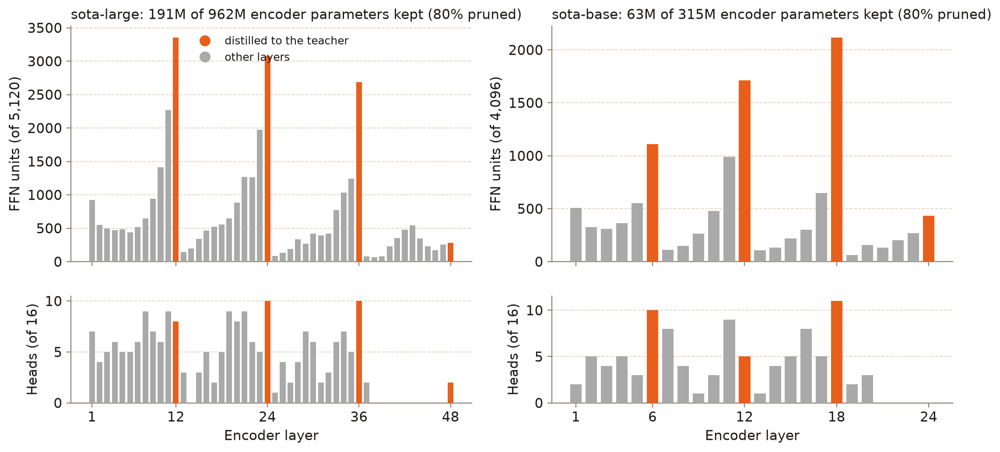

# Design and decisions

SOTA prunes Meta's Omnilingual ASR CTC models, `omniASR_CTC_1B` and `omniASR_CTC_300M`, to 80% encoder sparsity for Khmer and English. It is the ASR half of a later joint ASR + speaker-diarization model, in the spirit of DiariZen's pruned WavLM Base-s80 and Large-s80.

## 1. The recipe

The recipe follows *Fine-tune Before Structured Pruning* (Han et al., arXiv 2505.24111), which builds on DPHuBERT (Peng et al., arXiv 2305.17651) and the L0 relaxation of Louizos et al. (arXiv 1712.01312).

1. **Fine-tune first.** The full model is CTC fine-tuned on the target data. It then serves as both the pruning initialisation and the frozen teacher.
2. **Gates.** Hard Concrete L0 gates sit on every attention head and every FFN intermediate unit (`sota/hardconcrete.py`, ported from DiariZen).
3. **Constraint.** An augmented-Lagrangian term `λ1 (s − t) + λ2 (s − t)²` drives the expected sparsity `s` toward a target `t`.
   - `t` ramps linearly from 0 to 0.8 over the first 25% of steps.
   - The multipliers are trained by gradient ascent.
4. **Distillation.** The loss is L1 − cosine between student and teacher hidden states at a few layers:
   - 1B: 0, 12, 24, 36 and 48;
   - 300M: 0, 6, 12, 18 and 24.
5. **Cut.** The deterministic gates are folded into the weights and the zeroed heads and units are removed. `PrunableCTC` builds the smaller model, with a different width in each layer.
6. **Distil with the mask frozen** (Stage 2b), then **recover** (Stage 3) with CTC plus a frame-level KL divergence to the teacher's output distribution (temperature 1, weight 1).

## 2. Decisions and deviations from DiariZen

- **Fine-tune before pruning.** Pruning the stock 1B (experiment A in [RESULTS.md](RESULTS.md)) gave a good DDD model, but FLEURS-km and English were much worse. Fine-tuning first, with FLEURS in the mix, kept more of both.
- **Logit KD in Stage 3.** With CTC alone, LibriSpeech dev WER drifted upward during recovery. The KL term to the teacher's outputs stopped the drift and improved all five test sets. Doubling Stage 3 to 16k steps helped further.
- **Conv channels are not pruned.**
  - The Omnilingual feature extractor uses LayerNorm over channels in every conv layer. Removing channels changes those statistics, so pruning them is only approximate (`tests/test_model.py::test_conv_pruning_is_only_approximate`).
  - The conv stack is 0.4% of the 1B's parameters. Set `model.pruning_units: conv,head,interm` to turn it on.
- **The deepest distillation target is taken after the final LayerNorm.** The last target is distilled after the final encoder LayerNorm, which is the CTC head's input. The raw residual stream of a pre-LN model has an arbitrary scale at the top.
- **Gradient ascent on λ.** The multipliers' gradient is negated before an ordinary AdamW step, because current torch rejects the negative learning rate DPHuBERT used.
- **No checkpoint averaging.** Each run keeps one checkpoint, and the final one is pruned and carried forward.
- **Fixed FLEURS share.** FLEURS is about 1–2% of the audio at its natural share. In early tests, FLEURS-km dev CER rose from 10.7% to 13.1% in the first 1k steps of Stage 1. The mix therefore fixes FLEURS at 20% of each language's audio, repeating clips as needed.
- **Text.** The model emits Omnilingual's character vocabulary: lowercase, with no Khmer punctuation and no zero-width characters. Targets and CER references are filtered to that vocabulary, which affects 1.2% of DDD characters, mostly `។`.
- **Speaker information.** This pruning optimises for ASR, and the CTC fine-tune removes speaker information from the top layers. For the joint diarization model, expect to re-adapt the pruned encoder, or to re-prune from a diarization-tuned teacher as DiariZen does.

## 3. What pruning keeps

<p align="center">
  
</p>

- **Width follows the distillation targets.** FFN width peaks at the distilled layers, and the layer right after each target keeps the least.
- **The deepest layers lose all attention.** In the 1B, layers 38–47 keep no attention heads; in the 300M, layers 21–24.

## 4. Code map

```
sota/model.py               prunable wav2vec2 CTC with fairseq2's parameter names; prune(); num_params()
sota/hardconcrete.py        Hard Concrete gates (ported from DiariZen), pinned once per forward
sota/text.py                Omnilingual char vocabulary, normalisation, greedy CTC decoding
sota/asr.py, hub.py, cli.py the public API: load_model, transcribe, `sota` command
training/sota_train/convert.py   fairseq2 checkpoint -> {"arch", "model"} + logit parity check
training/sota_train/data.py      DDD/FLEURS-km + LibriSpeech/FLEURS-en mixed by audio seconds, resumable
training/sota_train/train.py     trainer for finetune | prune | distill (+ logit KD)
training/sota_train/offload.py   CPU-offloaded AdamW (1B) / GPU AdamW
training/sota_train/evaluate.py  CER/WER, real-time factor
```

The model's module tree mirrors fairseq2's `Wav2Vec2AsrModel`, so a stock checkpoint loads with a near-identity key map. The converted checkpoints reproduce the fairseq2 logits exactly: the maximum absolute difference is 0.0 in fp32, for both sizes.
